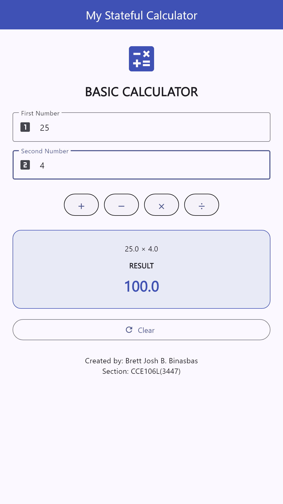
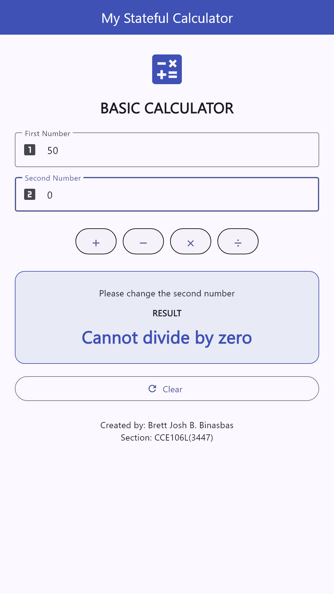
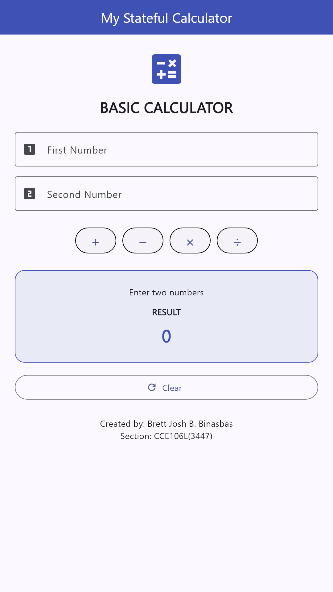
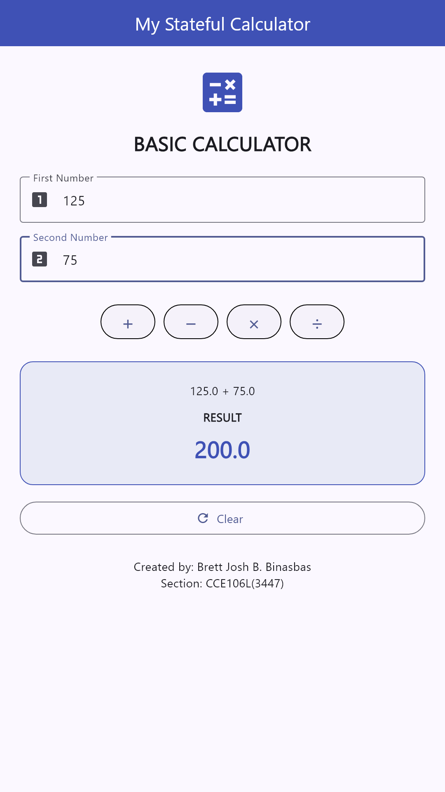
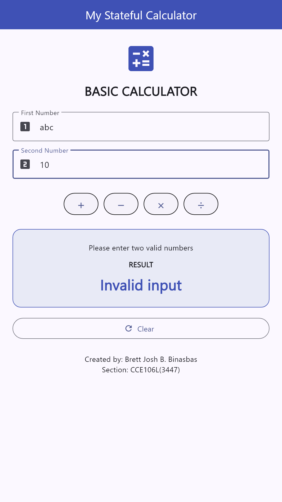
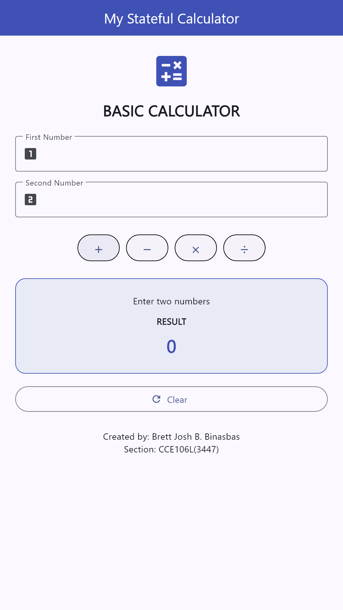

# Binasbas_calculator
### Laboratory Activity 4: Flutter Calculator Design and Code Tracing
**Topic:** `StatefulWidget`

---

## Student Information
- **Name:** Brett Josh B. Binasbas
- **Subject & Code:** CCE106L(3447)
- **Institution:** College of Computing Education
- **Project Name:** Binasbas_calculator

---

## Learning Objectives
By completing this laboratory activity, the following objectives were accomplished:
1. **Design a calculator interface** using Flutter layout widgets (`Scaffold`, `SingleChildScrollView`, `Column`, `TextField`, `Wrap`, `ElevatedButton`, `Container`, `OutlinedButton.icon`).
2. **Utilize `TextEditingController`** to retrieve, monitor, and clear user inputs safely from text fields.
3. **Trigger UI updates with `setState()`** to schedule widget rebuilds when calculation results and operation labels change.
4. **Implement arithmetic operations** including addition (`+`), subtraction (`−`), multiplication (`×`), and division (`÷`) with comprehensive error checking.
5. **Trace input values and execution flow** through the Flutter reactive architecture from input entry to UI rendering.

---

## Application Architecture & Code Tracing

### How Input Values Move Through the Application:
```
[User Types Number 1]  -->  firstNumberController.text
[User Types Number 2]  -->  secondNumberController.text
                                   │
                           [Taps Operation (+, −, ×, ÷)]
                                   │
                         calculate(operation)
                                   │
              ┌────────────────────┴────────────────────┐
              ▼                                         ▼
   double.tryParse() Validation                Zero-Division Check
   (null or non-finite check)                  (operation == '÷' && second == 0)
              │                                         │
              ├─[Invalid] ──> setState(Invalid Input)   ├─[Zero Div] ──> setState(Cannot divide by zero)
              │                                         │
              └─[Valid]                                 │
                   │                                    │
           switch(operation)                            │
        (compute arithmetic answer)                     │
                   │                                    │
              setState() ◄──────────────────────────────┘
         (Updates result & operationLabel)
                   │
           Framework Rebuild
         (build() re-executes)
                   │
            Updated Display
```

1. **Input Acquisition (`TextEditingController`):**
   `firstNumberController` and `secondNumberController` continuously track the text entered into each `TextField`.
2. **Event Dispatch:**
   Pressing an arithmetic `ElevatedButton` triggers `onPressed: () => calculate('...')`.
3. **Parsing & Input Validation:**
   `double.tryParse()` converts input strings to double values. If either field contains invalid or missing text, `result` is set to `'Invalid input'`.
4. **Division Guard:**
   Before performing division, the method checks `if (operation == '÷' && second == 0)`. If true, `result` is safely set to `'Cannot divide by zero'` without crashing.
5. **State Update (`setState`):**
   `setState()` marks the `_CalculatorScreenState` as dirty, causing Flutter to schedule a re-execution of `build()` to display the updated `result` and `operationLabel`.
6. **Reset (`clearCalculator`):**
   The `Clear` button triggers `.clear()` on both controllers and resets `result` to `'0'` and `operationLabel` to `'Enter two numbers'`.
7. **Resource Cleanup (`dispose`):**
   Both `TextEditingController` instances are released inside `dispose()` to prevent memory leaks.

---

## Visual Output & Documentation Screenshots

### 1. Successful Calculation (Multiplication: 25 × 4 = 100.0)


### 2. Division by Zero Message (50 ÷ 0)


### 3. Additional Test Cases
| Initial Screen | Addition (125 + 75 = 200.0) | Invalid Input | Cleared State |
|:---:|:---:|:---:|:---:|
|  |  |  |  |

---

## How to Run This Project

### Prerequisites
- Flutter SDK (v3.13.0 or later)
- Dart SDK
- Chrome, Windows Desktop, or an Android emulator/device

### Execution Steps
```bash
# Clone the repository
git clone https://github.com/brettjoshbinasbas-ux/Binasbas_calculator.git

# Navigate to project directory
cd Binasbas_calculator

# Fetch dependencies
flutter pub get

# Run on available device (Chrome / Windows / Android)
flutter run

# Run automated widget tests
flutter test
```

---

## Project Structure
```
binasbas_calculator/
├── android/
├── ios/
├── lib/
│   ├── calculator_screen.dart   # Calculator StatefulWidget & UI
│   └── main.dart                # Application entry point & theme
├── screenshots/
│   ├── 01_initial_screen.png
│   ├── 02_addition_successful.png
│   ├── 02_successful_calculation.png
│   ├── 03_division_by_zero.png
│   ├── 04_invalid_input.png
│   └── 05_cleared_screen.png
├── test/
│   ├── capture_screenshots_test.dart
│   └── widget_test.dart
├── pubspec.yaml
└── README.md
```
